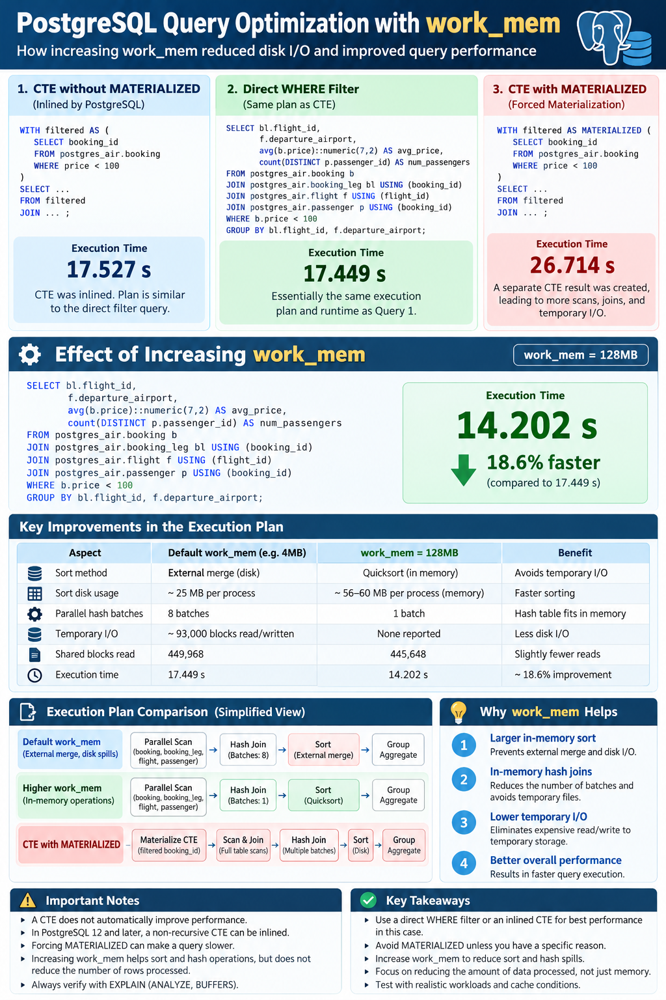
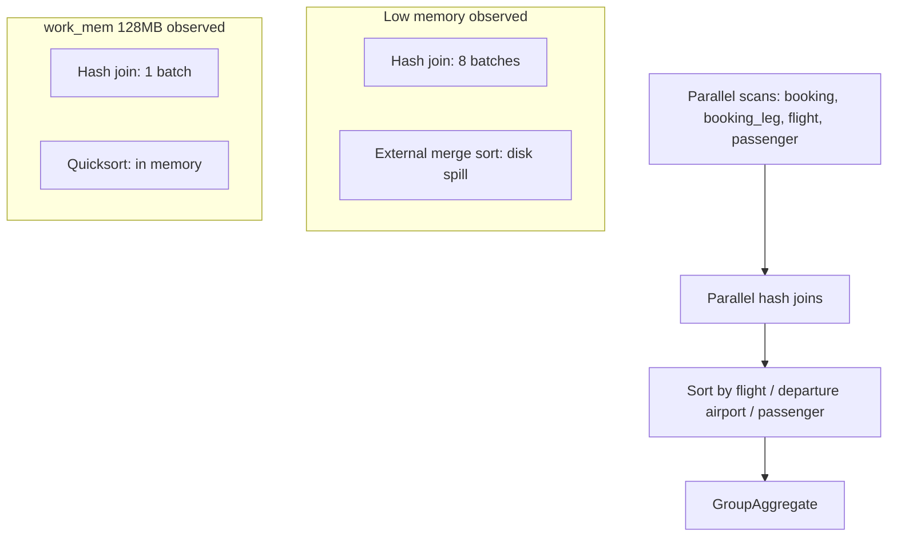

# 03 — Recorded Tuning Results and Plan Diagrams

This file records specific results observed during the lab. Treat them as **measurements from those runs**, not promised performance outcomes.

## 1. PostgreSQL aggregation: CTE versus direct filter

Query workload: join `postgres_air.booking`, `booking_leg`, `flight`, and `passenger`, filter `b.price < 100`, then group by flight and departure airport.

| Variant | Recorded execution time | Interpretation from the recorded run |
|---|---:|---|
| CTE without `MATERIALIZED` | 17.527 s | CTE was inlined; plan was similar to direct filter |
| Direct `WHERE` filter | 17.449 s | Essentially the same plan/runtime in this run |
| CTE with `AS MATERIALIZED` | 26.714 s | Forced separate CTE result; more work and temporary I/O |
| Direct query with `work_mem = 128MB` | 14.202 s | Sort changed from external merge to in-memory quicksort; parallel hash join changed from 8 batches to 1 |

The direct query at 14.202 seconds was approximately **18.6% faster** than the 17.449-second direct-query run. This is a comparison of these runs only; repeat measurements under controlled cache/load conditions before making a general performance claim.

## 2. Poster



## 3. Simplified plan-shape diagram



The Mermaid diagram is conceptual: it summarizes the recorded differences and is not a literal rendering of every node in the full `EXPLAIN` output.

## 4. Why the `work_mem` result changed

In the recorded plan:

- The sort changed from **external merge** (temporary files) to **quicksort** (memory).
- Parallel hash join batches changed from **8** to **1**.
- The plan no longer reported the earlier large volume of temporary blocks read/written.
- Runtime changed from 17.449 seconds to 14.202 seconds in those runs.

`work_mem` is a per-operation limit, not a total query-memory budget. Multiple sort/hash operations and parallel workers can multiply memory consumption. Raising it globally without workload analysis can create memory pressure.

## 5. `demo.big_table1`: index and I/O parameter experiment

The demo uses the following query:

```sql
EXPLAIN (ANALYZE, BUFFERS, TIMING OFF)
SELECT *
FROM demo.big_table1
WHERE val BETWEEN 100000 AND 150000;
```

The lab notes compare `effective_io_concurrency = 1` and `64` with `work_mem = 256MB`. Record the actual plan and timings from the server where you run it; do **not** transfer the `postgres_air` aggregation timings to this different query.

`effective_io_concurrency` primarily affects asynchronous prefetch behavior for supported access paths, especially bitmap heap scans. It does not guarantee a speedup for ordinary index scans or sequential scans. Check whether the plan actually uses an affected path.

## 6. Repeatable measurement checklist

For each experiment, capture:

1. Exact SQL and session settings.
2. `EXPLAIN (ANALYZE, BUFFERS, TIMING OFF)` output.
3. Plan node changes and estimated versus actual rows.
4. Shared buffer hits/reads and temporary blocks read/written.
5. Sort method/disk use and hash batches/memory where present.
6. Runtime across repeated trials, noting cache state and concurrent activity.
7. Whether the result set is equivalent before and after a query rewrite.
