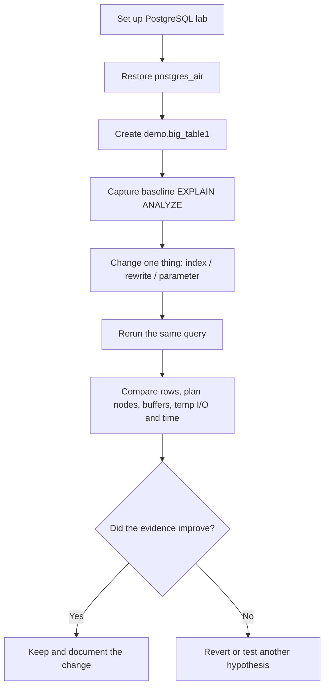

# PostgreSQL Indexing, Partitioning & Performance Tuning — Markdown Lab Pack

This pack follows the hands-on sequence used in the live demo:

**Baseline → inspect `EXPLAIN` → make one change → rerun the same query → compare evidence.**

## Files

1. [`01_LAB_SETUP.md`](01_LAB_SETUP.md) — download/restore `postgres_air`, create `demo.big_table1`, verify the lab.
2. [`02_LIVE_DEMO_RUNBOOK.md`](02_LIVE_DEMO_RUNBOOK.md) — full indexing, query rewrite, partitioning and tuning runbook.
3. [`03_RECORDED_TUNING_RESULTS.md`](03_RECORDED_TUNING_RESULTS.md) — recorded query timings and what the plans showed.
4. [`images/work_mem_tuning_poster.png`](images/work_mem_tuning_poster.png) — visual poster embedded by reference in the results file.

## Lab flow

## Important benchmark note

Timings in the runbook are observations from particular lab runs, not universal guarantees. Cache state, concurrent load, storage, PostgreSQL version, table statistics and planner settings can change the result. Keep the query and parameters constant and capture the complete plan before making a conclusion.
