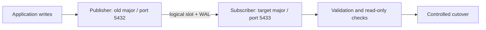

# SOP 07 — End-to-end logical replication lab, limitations, workarounds and upgrade

## Goal
Create reproducible publisher and subscriber clusters, publish example banking-style data, demonstrate updates/deletes, identify built-in logical replication limitations, apply safe workarounds, then perform a major-version migration/cutover rehearsal.

## Architecture


## 1. Prerequisites and safety
Two test clusters (or VMs/containers) with network connectivity. Publisher listens on 5432, subscriber on 5433. Use TLS and a least-privilege replication role in real environments. Lab passwords below are intentionally not embedded. Configure `listen_addresses`, `pg_hba.conf`, `wal_level=logical`, `max_replication_slots`, `max_wal_senders`, `max_logical_replication_workers`, and `max_worker_processes` as appropriate for your version; restart if required. Open only the needed network path.

Create a replication role on publisher:
```sql
CREATE ROLE repl_user WITH LOGIN REPLICATION;
-- Set password interactively with \password repl_user in psql.
```
Add a restrictive `host`/`hostssl` entry in publisher `pg_hba.conf` for the subscriber address and database. Reload and test connectivity. Do not use `trust` in production.

## 2. Publisher schema and data
Run on publisher:
```sql
CREATE DATABASE labpub;
\connect labpub
CREATE SCHEMA app;
CREATE TABLE app.customer (
  customer_id bigint GENERATED BY DEFAULT AS IDENTITY PRIMARY KEY,
  full_name text NOT NULL,
  email text UNIQUE NOT NULL,
  profile jsonb NOT NULL DEFAULT '{}'::jsonb,
  created_at timestamptz NOT NULL DEFAULT clock_timestamp()
);
CREATE TABLE app.payment (
  payment_id bigint GENERATED BY DEFAULT AS IDENTITY PRIMARY KEY,
  customer_id bigint NOT NULL REFERENCES app.customer(customer_id),
  amount numeric(12,2) NOT NULL CHECK (amount > 0),
  status text NOT NULL CHECK (status IN ('NEW','SETTLED','FAILED')),
  memo text
);
INSERT INTO app.customer(full_name,email,profile)
SELECT 'Customer '||g, 'customer'||g||'@example.test',
       jsonb_build_object('tier', CASE WHEN g%3=0 THEN 'gold' ELSE 'standard' END)
FROM generate_series(1,100) g;
INSERT INTO app.payment(customer_id,amount,status,memo)
SELECT ((g-1)%100)+1, (g%5000+1)::numeric/10,
       CASE WHEN g%4=0 THEN 'SETTLED' ELSE 'NEW' END,
       repeat('x', CASE WHEN g%10=0 THEN 12000 ELSE 40 END)
FROM generate_series(1,1000) g;
```
Long `memo` values demonstrate TOAST-backed storage when PostgreSQL chooses out-of-line compression; they do not guarantee every value is stored out of line.

Create publication after schema/data:
```sql
CREATE PUBLICATION app_pub FOR TABLE app.customer, app.payment;
```
For all tables, `FOR ALL TABLES` has additional privileges and database-wide semantics; use only when intended. Check:
```sql
SELECT * FROM pg_publication_tables ORDER BY schemaname, tablename;
```

## 3. Subscriber setup
Create `labsub` on subscriber and create the same schema/tables (DDL is not automatically replicated):
```sql
CREATE DATABASE labsub;
\connect labsub
CREATE SCHEMA app;
CREATE TABLE app.customer (
  customer_id bigint GENERATED BY DEFAULT AS IDENTITY PRIMARY KEY,
  full_name text NOT NULL,
  email text UNIQUE NOT NULL,
  profile jsonb NOT NULL DEFAULT '{}'::jsonb,
  created_at timestamptz NOT NULL DEFAULT clock_timestamp()
);
CREATE TABLE app.payment (
  payment_id bigint GENERATED BY DEFAULT AS IDENTITY PRIMARY KEY,
  customer_id bigint NOT NULL REFERENCES app.customer(customer_id),
  amount numeric(12,2) NOT NULL CHECK (amount > 0),
  status text NOT NULL CHECK (status IN ('NEW','SETTLED','FAILED')),
  memo text
);
```
Create subscription (replace hostname and connect options; use a protected `.pgpass` file with mode 0600 rather than a password literal):
```sql
CREATE SUBSCRIPTION app_sub
CONNECTION 'host=publisher.example port=5432 dbname=labpub user=repl_user sslmode=verify-full'
PUBLICATION app_pub
WITH (copy_data = true, create_slot = true, enabled = true);
```
Use a valid certificate CA/hostname configuration for `verify-full`. If running in an isolated disposable lab without TLS, explicitly document that exception and never carry it into production. Subscription owner/permissions and subscription connection settings must match your PostgreSQL version.

## 4. Validate initial copy
On publisher and subscriber:
```sql
SELECT count(*) FROM app.customer;
SELECT count(*) FROM app.payment;
SELECT sum(amount) FROM app.payment;
```
Check subscriber:
```sql
SELECT subname, pid, received_lsn, latest_end_lsn, latest_end_time
FROM pg_stat_subscription;
```
`pg_stat_subscription` fields differ by version. Inspect `\d+ pg_stat_subscription` and version docs when needed. Wait for initial table synchronization to finish before declaring success.

## 5. Demonstrate change capture
Publisher:
```sql
UPDATE app.payment SET status='SETTLED' WHERE payment_id BETWEEN 1 AND 20;
INSERT INTO app.customer(full_name,email) VALUES ('Replication Test','replication-test@example.test');
DELETE FROM app.payment WHERE payment_id=1000;
```
Subscriber:
```sql
SELECT status, count(*) FROM app.payment GROUP BY status ORDER BY status;
SELECT * FROM app.customer WHERE email='replication-test@example.test';
SELECT count(*) FROM app.payment WHERE payment_id=1000;
```
Changes should appear after replication lag. Do not use the same IDs for independent writes on subscriber.

## 6. Limitations and workarounds
| Limitation | Operational workaround |
|---|---|
| DDL is not replicated | Use migration tooling/release process; apply compatible DDL to subscriber before publisher starts writing the new shape. |
| Sequences/identity sequence state is not replicated | At cutover, freeze writes and synchronize sequence state using `setval` from source values. Validate next generated key. |
| Large objects (`pg_largeobject`) are not replicated | Transfer with `pg_dump`/`pg_restore` or a dedicated object migration process; verify LO OIDs/content. |
| UPDATE/DELETE need replica identity | Prefer primary key; otherwise `ALTER TABLE ... REPLICA IDENTITY FULL` has performance/WAL costs. |
| Foreign-key/order interactions | Ensure related tables are included and initial load is complete; test constraints and load ordering. |
| Conflicting subscriber writes | Keep subscriber read-only for replicated tables; avoid dual writes or design explicit conflict handling. |
| Partitioning, row filters, column lists, generated columns | Validate exact source/target version behavior and test representative DML. |
| WAL retained by slot | Alert on slot lag and `pg_wal` growth; have a documented slot reset/resync procedure. |
| Schema drift | Version schema changes and deploy in compatible order; compare schema hashes/catalogs. |
| Unsupported types/extensions | Verify target extension and type support; use conversion/staging if incompatible. |

Replica identity example:
```sql
ALTER TABLE app.payment REPLICA IDENTITY DEFAULT;
-- If no suitable key and business requirements permit (expensive):
-- ALTER TABLE app.some_table REPLICA IDENTITY FULL;
```

Sequence cutover example: run after write freeze, obtain the source sequence name/value using `pg_get_serial_sequence` and `last_value/is_called` on the source, then set the target sequence. Do not blindly assume identity sequence names; inspect them:
```sql
SELECT pg_get_serial_sequence('app.customer','customer_id');
```
The sequence state query and `setval` command should be generated for the actual returned sequence. Sequence state is not an ordinary replicated row.

## 7. Upgrade/cutover rehearsal
1. Create a new target-major subscriber cluster and install target extension packages.
2. Apply schema and required reference data; set up publication/subscription with compatible versions.
3. Let initial copy complete; compare counts, aggregates, critical business invariants and sample rows.
4. Observe slot/WAL retention, apply lag, errors, disk and network during representative write load.
5. Freeze source writes and background jobs. Wait for subscriber to catch up; record final LSNs and counts.
6. Synchronize sequence state and any non-replicated objects/large objects.
7. Run application read-only smoke tests against target; validate roles, grants, extensions, collations, functions, triggers and scheduled jobs.
8. Change application endpoint to target; enable writes only on target.
9. Monitor errors, duplicates, constraint violations, latency and logical workers.
10. Retain source read-only for the agreed rollback window. Do not resume writes on source unless reverse replication/reconciliation is explicitly designed.

## 8. Troubleshooting
- **Connection refused:** check route/security group/firewall, `listen_addresses`, port and service state.
- **No pg_hba entry:** add a narrow rule for subscriber host/user/database, reload and retest.
- **Permission denied:** verify role LOGIN/REPLICATION, publication ownership/table privileges and subscription owner privileges for version.
- **Table missing:** create compatible schema before subscription; DDL does not flow.
- **UPDATE/DELETE fails:** check replica identity and unique keys.
- **Slot disk growth:** inspect `pg_replication_slots`, subscriber health, WAL disk; do not drop a slot until impact and resync plan are approved.
- **Schema mismatch:** stop cutover, reconcile schema on both sides, test in staging; don't suppress errors blindly.

## 9. Pass criteria
All published tables synchronized; representative INSERT/UPDATE/DELETE visible; counts/aggregates and business invariants match; no persistent apply errors; slot/WAL usage bounded; sequence/LO/DDL workarounds documented; target application smoke tests pass.
